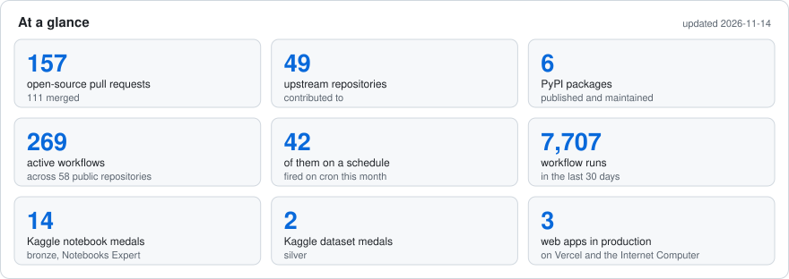

# Yasunori Morishima (盛島康徳)
Manufacturing Engineer & Data Analyst with <!-- CAREER_YEARS_START -->18<!-- CAREER_YEARS_END --> years of experience, specializing in data analysis, open source contribution, and business automation.

 2026-06-01時点: 73.0

<picture>
  <source media="(prefers-color-scheme: dark)" srcset="https://raw.githubusercontent.com/yasumorishima/yasumorishima/main/assets/dashboard-dark.svg">
  
</picture>

**Jump to** — [Robotics](#-robotics--embedded) · [Baseball websites](#-baseball-websites) · [Baseball analytics](#-baseball-analytics) · [Realtime open data](#-realtime-open-data) · [Document OCR](#-document-ocr) · [Open source](#-open-source-contributions) · [Competitions](#-data--competitions) · [Apps](#-mobile--web-apps) · [PyPI](#-pypi-packages) · [Learning](#-learning-projects) · [Profile](#-profile)

## 🤖 Robotics / Embedded

- **[stackchan-lab](https://github.com/yasumorishima/stackchan-lab)** — M5 Stack-chan on a self-hosted Raspberry Pi 5 voice server: tools over MCP, sings cheer songs · [server notes](https://github.com/yasumorishima/stackchan-lab/tree/main/server#readme) · 🔒 [stackchan-logs](https://github.com/yasumorishima/stackchan-logs) · 🔒 [stackchan-cache](https://github.com/yasumorishima/stackchan-cache)
- **[rpi5-infra](https://github.com/yasumorishima/rpi5-infra)** 🔒 — config record for the Pi 5 (firewall, systemd, cron), no secrets

## ⚾ Baseball Websites

<table>
<tr>
<td align="center"><b>PC (Light)</b></td>
<td align="center"><b>Game Results</b></td>
</tr>
<tr>
<td></td>
<td></td>
</tr>
</table>

- **[Minami Baseball OB](https://minami-baseball-ob.vercel.app/)** — alumni association site in production · <!--ob:active_users-->11<!--/ob--> users · <!--ob:pages-->44<!--/ob--> pages · <!--ob:db_tables-->23<!--/ob--> tables · <!--ob:e2e_tests-->19<!--/ob--> e2e tests · <!--ob:senseki-->686<!--/ob--> games since 1955 · <!--ob:cost-->¥0<!--/ob-->/mo (<!--ob:ts_files-->159<!--/ob--> files, <!--ob:loc-->~22500<!--/ob--> LOC) · [docs](https://github.com/yasumorishima/minami-baseball-ob-docs)
- **[Yokohama Funnies](https://yokohama-funnies.vercel.app/)** — amateur team site in production, with per-game stats · <!--fn:players-->23<!--/fn--> players · <!--fn:pages-->48<!--/fn--> pages · <!--fn:db_tables-->32<!--/fn--> tables · <!--fn:e2e_tests-->19<!--/fn--> e2e tests · <!--fn:cost-->¥0<!--/fn-->/mo (<!--fn:ts_files-->175<!--/fn--> files, <!--fn:loc-->~24700<!--/fn--> LOC) · [docs](https://github.com/yasumorishima/yokohama-funnies-docs)

`Next.js / TypeScript / Supabase / Vercel / GitHub Actions / Google Apps Script`

## ⚾ Baseball Analytics

MLB Statcast and public NPB stats, free tiers only. Forecasts are pre-registered and scored against simple baselines.

**Strategy & scouting**
- [MLB Win Probability Engine](https://github.com/yasumorishima/mlb-win-probability) · [Live](https://mlb-wp-engine.streamlit.app/) · [steal study](https://github.com/yasumorishima/mlb-win-probability/blob/master/research/steal_claude/RESULTS.md)
- [NPB Season & Team Prediction](https://github.com/yasumorishima/npb-prediction) · [Live](https://npb-prediction.streamlit.app/) · [2026 team result](https://github.com/yasumorishima/npb-prediction/blob/main/data/backtest/2026_team_result.md) · [2021 backtest](https://github.com/yasumorishima/npb-prediction/tree/main/research/2021-backtest) · [JP](https://zenn.dev/shogaku/articles/npb-bayes-integration-production) / [EN](https://dev.to/yasumorishima/adding-bayesian-ensemble-monte-carlo-to-an-npb-prediction-app-58po)
- [Next-Pitch Forecast](https://github.com/yasumorishima/mlb-pitch-forecast) · [results](https://github.com/yasumorishima/mlb-pitch-forecast/blob/main/RESULTS.md) · [API](https://mlb-pitch-forecast.vercel.app/api/predict)
- [Pitch Shape × Swing Shape](https://github.com/yasumorishima/kaggle-datasets/tree/matchup-diag/pitch-swing-matchup) *(in progress)*
- [NPB Foreign Player Study](https://github.com/yasumorishima/npb-foreign-statcast)
- [Aging Curve & Development Tracker](https://github.com/yasumorishima/baseball-bayes) · [tracker](https://github.com/yasumorishima/baseball-bayes/tree/main/development)
- [Which KPIs Carry Over](https://github.com/yasumorishima/mlb-data-pipeline) · [JP](https://qiita.com/ussu_ussu_ussu/items/81b75c0020bf2e1d84f3) / [EN](https://dev.to/yasumorishima/does-a-pitchs-performance-carry-over-to-next-season-whiff-rate-vs-run-value-on-8022-mlb-pairs-bj)
- [Player Condition Monitoring](https://github.com/yasumorishima/kaggle-datasets#4-mlb-statcast--bat-tracking-2024-2026) · [Ohtani](https://www.kaggle.com/code/yasunorim/ohtani-2026-could-the-slump-be-seen-early) / [All hitters](https://www.kaggle.com/code/yasunorim/ohtani-2026-pattern-across-every-mlb-hitter) / [Anomaly](https://www.kaggle.com/code/yasunorim/do-hitters-drift-from-normal-before-the-il)
- [Jev as a Baseball Prior](https://github.com/yasumorishima/jev-baseball) · [JP](https://qiita.com/ussu_ussu_ussu/items/cc28f711396515c1fb31) / [EN](https://dev.to/yasumorishima/asking-a-decision-only-ai-typesafe-jev-to-forecast-next-seasons-hitting-worth-about-20-to-50-360k)

**Dashboards & apps**
- Scouting dashboards · [Looker](https://lookerstudio.google.com/reporting/9c1d9fa2-c796-45a0-85de-633a888c4fd9) · [Tableau](https://public.tableau.com/app/profile/y.m7878/viz/MLBScoutingDashboard/1)
- [WBC 2026 Scouting](https://github.com/yasumorishima/wbc-scouting) — 37 browser apps · [All 37](https://yasumorishima.github.io/wbc-scouting/) / [Japan Pitchers](https://yasumorishima.github.io/wbc-scouting/japan-pitchers.html)
- [MLB Bat Tracking Dashboard](https://github.com/yasumorishima/mlb-bat-tracking-dashboard) · [Live](https://yasumorishima-mlb-bat-tracking.streamlit.app/)

**MLOps & data platform**
- [MLB Data Pipeline](https://github.com/yasumorishima/mlb-data-pipeline) — weekly Hugging Face dataset + dbt marts · [HF Dataset](https://huggingface.co/datasets/yasumorishima/mlb-stats)
- [Baseball MLOps Pipeline](https://github.com/yasumorishima/baseball-mlops) · [Live](https://baseball-mlops.streamlit.app/)
- [savant-extras](https://github.com/yasumorishima/savant-extras) · [PyPI](https://pypi.org/project/savant-extras/)

**Vision & language**

<table>
<tr>
<td align="center"><b>Pitching Skeleton (3D C3D)</b></td>
<td align="center"><b>Hitting Skeleton (3D C3D)</b></td>
</tr>
<tr>
<td></td>
<td></td>
</tr>
</table>

- [Baseball Skeleton Analysis](https://github.com/yasumorishima/baseball-cv) — 3D skeletons from Driveline C3D · [JP](https://zenn.dev/shogaku/articles/baseball-cv-skeleton-biomechanics) / [EN](https://dev.to/yasumorishima/3d-skeleton-detection-from-baseball-motion-capture-data-with-driveline-c3d-29ja)
- [One-camera pitching pose](https://github.com/yasumorishima/pitching-pose-one-camera) *(in progress)*
- [Ask the marts in Japanese](https://github.com/yasumorishima/stackchan-lab/blob/main/server/mlb_ask.py) — spoken MLB questions to DuckDB, on Stack-chan

Statcast player analyses (<!-- MLB_STATS_START -->11 analyses<!-- MLB_STATS_END -->)

- Kikuchi Slider Revolution · [Zenn](https://zenn.dev/shogaku/articles/kikuchi-slider-revolution-2019-2025) / [DEV.to](https://dev.to/yasumorishima/yusei-kikuchis-pitching-evolution-a-statcast-analysis-2019-2025-2a4a) / [Kaggle](https://www.kaggle.com/code/yasunorim/yusei-kikuchi-slider-revolution-2019-2025)
- Senga Ghost Fork · [Zenn](https://zenn.dev/shogaku/articles/senga-ghost-fork-analysis-2023-2025) / [DEV.to](https://dev.to/yasumorishima/kodai-sengas-ghost-fork-analyzed-with-statcast-data-2023-2025-1k1d) / [Kaggle](https://www.kaggle.com/code/yasunorim/kodai-senga-ghost-fork-analysis-2023-2025)
- Imanaga 2nd Year · [Zenn](https://zenn.dev/shogaku/articles/imanaga-2nd-year-analysis-2024-2025) / [DEV.to](https://dev.to/yasumorishima/shota-imanagas-sophomore-year-what-statcast-data-reveals-2024-2025-235) / [Kaggle](https://www.kaggle.com/code/yasunorim/imanaga-rookie-to-sophomore-pitching)
- Darvish Evolution · [Zenn](https://zenn.dev/shogaku/articles/darvish-pitching-evolution-2021-2025) / [DEV.to](https://dev.to/yasumorishima/yu-darvishs-pitching-evolution-2021-2025-a-statcast-data-analysis-fij) / [Kaggle](https://www.kaggle.com/code/yasunorim/yu-darvish-pitching-evolution-2021-2025)
- Ohtani Spray Chart · [Zenn](https://zenn.dev/shogaku/articles/pybaseball-spraychart-builtin) — Ohtani Heatmap · [Zenn](https://zenn.dev/shogaku/articles/pybaseball-spraychart-matplotlib)
- [2022-2024 analyses (5)](https://github.com/yasumorishima/mlb-statcast-visualization/tree/main/analyses-2022-2024) · [2026 update](https://github.com/yasumorishima/mlb-statcast-visualization/tree/main/update-2026)

## 🌍 Realtime Open Data

<table>
<tr>
<td align="center"><a href="https://github.com/yasumorishima/japan-geohazard-monitor"><b>Japan Geohazard Monitor</b></a></td>
<td align="center"><a href="https://github.com/yasumorishima/hormuz-ship-tracker"><b>Persian Gulf Ship Tracker</b></a></td>
</tr>
<tr>
<td></td>
<td></td>
</tr>
</table>

- **[Japan Geohazard Monitor](https://github.com/yasumorishima/japan-geohazard-monitor)** — 31 open sources → earthquake prediction research · [research log](https://github.com/yasumorishima/japan-geohazard-monitor/blob/master/RESEARCH-LOG.md) · [Kumamoto InSAR](https://github.com/yasumorishima/japan-geohazard-monitor/tree/master/research/kumamoto2026_insar) · 🔒 [restricted inputs](https://github.com/yasumorishima/geohazard-restricted-inputs)
- **[Persian Gulf Ship Tracker](https://github.com/yasumorishima/hormuz-ship-tracker)** — AIS + Sentinel-1 radar · [map](https://yasumorishima.github.io/hormuz-ship-tracker/)
- **[Japan Wildlife Sightings](https://github.com/yasumorishima/japan-wildlife-sightings)** — bear and wildlife sightings from 27 sources in one schema · [map](https://yasumorishima.github.io/japan-wildlife-sightings/) · [licences](https://github.com/yasumorishima/japan-wildlife-sightings/blob/main/docs/licenses.md)
- **[Earth Vital Signs](https://github.com/yasumorishima/earth-vital-signs)** — sea ice, CO2, temperature, El Niño, rebuilt daily
- **[Japan Road Traffic](https://github.com/yasumorishima/japan-road-traffic)** — ~2,000 highway counters, archived daily before the source drops them
- [All projects](https://github.com/yasumorishima/realtime-open-data)

## 🧾 Document OCR

No cloud OCR and no generative model in the read path; the same page always reads the same.

- **[Handwritten Scorebook OCR](https://github.com/yasumorishima/baseball-scorebook-ocr)** 🔒 — paper scorebook photos → at-bat data, 92% on 33 graded sheets · [write-up (JP)](https://github.com/yasumorishima/baseball-scorebook-ocr-docs)
- **[Business-Form PDF Extraction](https://github.com/yasumorishima/form-ocr-lab)** 🔒 — supplier PDFs → spreadsheet, reconciled against the printed total

## 🌐 Open Source Contributions

<!-- OSS_STATS_START -->(137 PRs / 92 Merged)<!-- OSS_STATS_END --> across 49 repositories · [oss-contributions](https://github.com/yasumorishima/oss-contributions)

PR highlights

- **daisy/MathCAT** — Japanese speech rules, 25 merged PRs ([#720-929](https://github.com/daisy/MathCAT/pull/929), [#936](https://github.com/daisy/MathCAT/pull/936)) · [#746](https://github.com/daisy/MathCAT/pull/746) navigation · [#665](https://github.com/daisy/MathCAT/pull/665) chemistry tests
- **project-inclusive/OpenFisca-Japan** — six welfare benefits ([#479-484](https://github.com/project-inclusive/OpenFisca-Japan/pull/479))
- **codeforjapan** — mapprint [#556](https://github.com/codeforjapan/mapprint/pull/556) · [#563](https://github.com/codeforjapan/mapprint/pull/563) · [#564](https://github.com/codeforjapan/mapprint/pull/564) · BirdXplorer [#281](https://github.com/codeforjapan/BirdXplorer/pull/281)
- **dfinity/icp-js-core** [#1270](https://github.com/dfinity/icp-js-core/pull/1270) · **line/line-bot-mcp-server** [#369](https://github.com/line/line-bot-mcp-server/pull/369) · **pyomeca/ezc3d** [#384](https://github.com/pyomeca/ezc3d/pull/384) · **hotosm/openaerialmap** [#289](https://github.com/hotosm/openaerialmap/pull/289)
- **apache/fineract-backoffice-ui** [#321](https://github.com/apache/fineract-backoffice-ui/pull/321) · **PHPOffice/PHPPresentation** [#897](https://github.com/PHPOffice/PHPPresentation/pull/897) · **MobilityData/gtfs-validator** [#2177](https://github.com/MobilityData/gtfs-validator/pull/2177) · **sugarlabs/musicblocks-v4** [#774](https://github.com/sugarlabs/musicblocks-v4/pull/774)
- **AtsushiSakai/PythonRobotics** [#1408](https://github.com/AtsushiSakai/PythonRobotics/pull/1408) · **jldbc/pybaseball** [#514](https://github.com/jldbc/pybaseball/pull/514) · optuna · pandas
- **team-mirai** (<!-- TEAM_MIRAI_STATS_START -->26 PRs (14 Merged / 4 Open / 8 Closed)<!-- TEAM_MIRAI_STATS_END -->) — action-board [#1969](https://github.com/team-mirai-volunteer/action-board/pull/1969) · [#1869](https://github.com/team-mirai-volunteer/action-board/pull/1869) · [#1849](https://github.com/team-mirai-volunteer/action-board/pull/1849) · [#1845](https://github.com/team-mirai-volunteer/action-board/pull/1845) · mirai-gikai [#930](https://github.com/team-mirai/mirai-gikai/pull/930) · [#932](https://github.com/team-mirai/mirai-gikai/pull/932) · fact-checker [#69](https://github.com/team-mirai-volunteer/fact-checker/issues/69#issuecomment-3811711591)

## 📊 Data & Competitions

**Kaggle** — <!-- KAGGLE_COMP_STATS_START -->Notebooks Expert | 🥉 14 Bronze Notebook Medals<!-- KAGGLE_COMP_STATS_END --> · [All 14 notebooks](https://www.kaggle.com/yasunorim/code)
- 2026: [Kaggriculture](https://www.kaggle.com/competitions/kaggriculture) <!-- RANK_KAGGRICULTURE_START -->6047/10148<!-- RANK_KAGGRICULTURE_END --> ([agent](https://github.com/yasumorishima/kaggle-competitions/tree/main/kaggriculture)) · [ROGII Wellbore Geology](https://www.kaggle.com/competitions/rogii-wellbore-geology-prediction) <!-- RANK_ROGII_START -->2545/6125<!-- RANK_ROGII_END --> · [PS S6E6](https://www.kaggle.com/competitions/playground-series-s6e6) · [Stanford RNA 3D Folding 2](https://www.kaggle.com/competitions/stanford-rna-3d-folding-2) · [BirdCLEF+ 2026](https://www.kaggle.com/competitions/birdclef-2026)
- Medal notebooks: [savant-extras Defense](https://www.kaggle.com/code/yasunorim/savant-extras-defense-pitching-quality) · [WBC Spray Charts](https://www.kaggle.com/code/yasunorim/mlb-statcast-spray-charts-for-wbc-2026-players) · [March Mania 2026](https://www.kaggle.com/code/yasunorim/march-machine-learning-mania-2026-baseline) · [NFL Geometric Rules](https://www.kaggle.com/code/yasunorim/geometric-rules-baseline-2-921-rmse-no-ml) · [CAFA 6](https://www.kaggle.com/code/yasunorim/baseline-with-regularization)

**Kaggle Datasets** — <!-- KAGGLE_DS_STATS_START -->11 public datasets<!-- KAGGLE_DS_STATS_END -->
- 🥈 [MLB Bat Tracking](https://www.kaggle.com/datasets/yasunorim/mlb-bat-tracking-2024-2025) · 🥈 [WBC 2026 Scouting](https://www.kaggle.com/datasets/yasunorim/wbc-2026-scouting) · [Statcast + Bat Tracking](https://www.kaggle.com/datasets/yasunorim/mlb-statcast-bat-tracking-2024-2025) · [ABS Challenges](https://www.kaggle.com/datasets/yasunorim/mlb-abs-challenges-aaa-2025-to-mlb-2026) ([JP](https://qiita.com/ussu_ussu_ussu/items/57c5760b3f9917b3883f) / [EN](https://dev.to/yasumorishima/abs-challenges-from-triple-a-to-mlb-catchers-win-most-and-batters-who-dont-chase-win-more-499a)) · [Savant Leaderboards](https://www.kaggle.com/datasets/yasunorim/baseball-savant-leaderboards-2024) · [Japanese MLB Players](https://www.kaggle.com/datasets/yasunorim/japan-mlb-pitchers-batters-statcast) · [Pitcher Arsenal](https://www.kaggle.com/datasets/yasunorim/mlb-pitcher-arsenal-2020-2025) ([notebook](https://www.kaggle.com/code/yasunorim/pitcher-arsenal-analysis))
- [Earth Vital Signs](https://www.kaggle.com/datasets/yasunorim/earth-vital-signs-daily) · [Japan Road Traffic](https://www.kaggle.com/datasets/yasunorim/japan-road-traffic-volume) ([starter](https://www.kaggle.com/code/yasunorim/japan-road-traffic-a-forecasting-starter)) · [XC BirdCLEF 2026 URLs](https://www.kaggle.com/datasets/yasunorim/xc-birdclef-2026-target-urls) · [BEATs Pretrained](https://www.kaggle.com/datasets/yasunorim/beats-pretrained)

**SIGNATE** — Active: 5th Air Combat AI Challenge · 2026: NEDO Baggage-Loading Optimization <!-- RANK_NEDO_START -->167/591<!-- RANK_NEDO_END --> · NIR Moisture Prediction

**DrivenData** — [drivendata-comp](https://github.com/yasumorishima/drivendata-comp) · [On Top of Pasketti](https://www.drivendata.org/competitions/309/)

## 📱 Mobile & Web Apps

- **[Daily Diary](https://github.com/yasumorishima/diary-app-flutter)** — Flutter, 10 languages, TalkBack-checked in CI · [Google Play](https://play.google.com/store/apps/details?id=com.diary.daily)
- **[icrc167-android](https://github.com/yasumorishima/icrc167-android)** — Internet Identity login for native Android (ICRC-167) · [ii#4334](https://github.com/dfinity/internet-identity/issues/4334)
- **[Fire Tablet Google Play Helper](https://github.com/yasumorishima/yasumorishima.github.io/tree/main/fire-gapps)** · [Live](https://yasumorishima.github.io/fire-gapps/)

## 📦 PyPI Packages

[savant-extras](https://github.com/yasumorishima/savant-extras) · [baseball-field-viz](https://github.com/yasumorishima/baseball-field-viz) · [kaggle-notebook-deploy](https://github.com/yasumorishima/kaggle-notebook-deploy) · [kaggle-wandb-sync](https://github.com/yasumorishima/kaggle-wandb-sync) · [signate-deploy](https://github.com/yasumorishima/signate-deploy) · [signate-wandb-sync](https://github.com/yasumorishima/signate-wandb-sync)

## 🔬 Learning Projects

- **[Sansuu, Shogi & Sora](https://github.com/yasumorishima/icp-counter-learning)** — arithmetic, shogi, planetarium and toddler games, usable without sight · [Live](https://iqjbc-7aaaa-aaaaj-qnnsa-cai.icp0.io/)
- [OpenClaw Twitter Bot](https://github.com/yasumorishima/raspi-baseball-bot) (stopped) · [JP](https://zenn.dev/shogaku/articles/raspi-baseball-bot-openclaw-gemini) · 🔒 [alexa-rpi5](https://github.com/yasumorishima/alexa-rpi5) · 🔒 [Slide Decks with Claude Code](https://github.com/yasumorishima/slide-deck-with-claude-code)
- Past: [GAS Calendar Tool](https://github.com/yasumorishima/gas-calendar-tool) · [Dune Analytics](https://github.com/yasumorishima/dune-analytics) ([JPYC](https://dune.com/shogaku_toushi/jpyc-date)) · 🔒 [selenium-to-playwright](https://github.com/yasumorishima/selenium-to-playwright) · [Archived Projects](https://github.com/yasumorishima/archived-projects)

## 👤 Profile

**Tech** — Python (pandas, scikit-learn, LightGBM, PyTorch, DuckDB, W&B) · Hugging Face Datasets, dbt, BigQuery sandbox · Next.js, TypeScript, Supabase, Vercel, Streamlit · Flutter · GitHub Actions, Google Apps Script, VBA · Looker Studio, Tableau · Statistical Quality Control

**Career** — 2024–: Quality Management @ a semiconductor distributor · 2008–2024: Semiconductor Process Engineer (Toppan Printing 2008–2014, Toshiba → Kioxia 2014–2017)

**Patent** — Stencil mask and manufacturing method thereof ([JP6307851B2](https://patents.google.com/patent/JP6307851B2/ja))

**Contact** — [Site](https://yasumorishima.github.io) · [DEV.to](https://dev.to/yasumorishima) · [Zenn](https://zenn.dev/shogaku) · [Quarto Blog](https://yasumorishima.github.io/quarto-blog/) · [Kaggle](https://www.kaggle.com/yasunorim) · [Wantedly](https://www.wantedly.com/id/yasunori_morishima_b) · [LinkedIn](https://www.linkedin.com/in/morishima-yasunori-b70229241)
